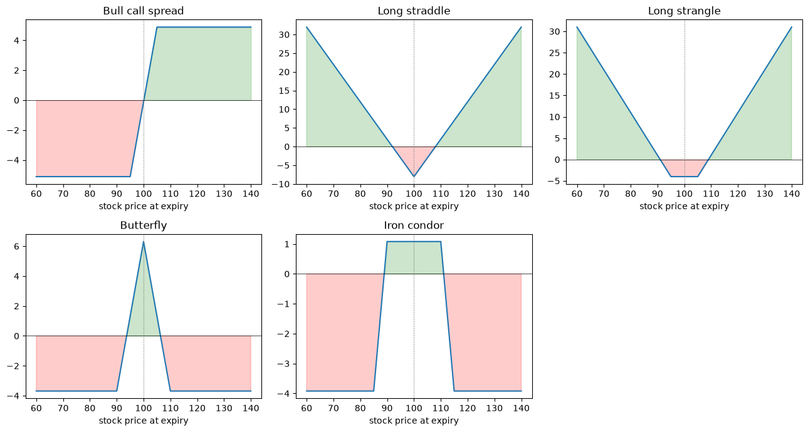

# Option Pricing in Python

Six short notebooks on option pricing and hedging: Black-Scholes, binomial
tree, Greeks, a barrier option, delta hedging and option strategies. Each one
runs in Google Colab (click the badge) and checks its own results.

Parameters used throughout: spot 100, strike 100, rate 3%, volatility 20%.

| Notebook | What it does | Check |
|---|---|---|
| [1. Black-Scholes](01_black_scholes.ipynb) [](https://colab.research.google.com/github/gianni04/option-pricing-python/blob/main/01_black_scholes.ipynb) | Call and put prices, implied volatility | Put-call parity holds exactly |
| [2. Binomial tree](02_binomial_tree.ipynb) [](https://colab.research.google.com/github/gianni04/option-pricing-python/blob/main/02_binomial_tree.ipynb) | European and American options | Converges to Black-Scholes (error 0.002 with 1,000 steps) |
| [3. Greeks](03_greeks.ipynb) [](https://colab.research.google.com/github/gianni04/option-pricing-python/blob/main/03_greeks.ipynb) | Delta, gamma, vega, theta, rho | Formulas match finite differences |
| [4. Barrier option](04_barrier_option.ipynb) [](https://colab.research.google.com/github/gianni04/option-pricing-python/blob/main/04_barrier_option.ipynb) | Down-and-out call, Monte Carlo vs formula | Monte Carlo within its confidence interval |
| [5. Delta hedging](05_delta_hedging.ipynb) [](https://colab.research.google.com/github/gianni04/option-pricing-python/blob/main/05_delta_hedging.ipynb) | Hedging error vs rebalancing frequency | Error falls like 1 / sqrt(n) |
| [6. Option strategies](06_option_strategies.ipynb) [](https://colab.research.google.com/github/gianni04/option-pricing-python/blob/main/06_option_strategies.ipynb) | Spreads, straddle, strangle, butterfly, iron condor | Cost, max profit, max loss, break-evens |

## Some results

- ATM call, 1 year: **9.41** (Black-Scholes), 9.41 with a 1,000-step tree.
- An American put is worth more than a European put (6.74 vs 6.45 at the
  money) because early exercise can pay; an American call without dividends
  is worth the same as the European call.
- A down-and-out call with a barrier at 90 costs 7.74 instead of 9.41. The
  Monte Carlo price (8.00) is higher because the barrier is only checked once
  a day; shifting the barrier (Broadie-Glasserman-Kou correction) gives 7.97.
- Delta hedging a 3-month call: the P&L error falls from 1.57 (4 rebalances)
  to 0.22 (252 rebalances).




## Run locally

```bash
pip install -r requirements.txt
jupyter notebook
```
