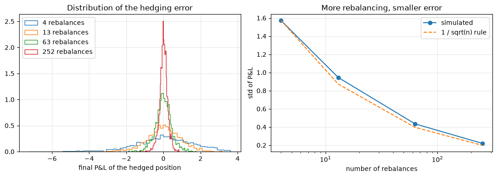

# Option Pricing in Python

Six notebooks on option pricing and hedging: Black-Scholes, binomial tree, Greeks, a barrier option, delta hedging and option strategies. Each notebook checks its own results.

A short note with the method and results: [note/option-pricing-python.pdf](note/option-pricing-python.pdf).

## Method

- `01_black_scholes.ipynb`: call and put prices, implied volatility. Put-call parity holds.
- `02_binomial_tree.ipynb`: European and American options, compared with Black-Scholes.
- `03_greeks.ipynb`: delta, gamma, vega, theta, rho, checked against finite differences.
- `04_barrier_option.ipynb`: down-and-out call priced by Monte Carlo and by formula.
- `05_delta_hedging.ipynb`: hedging error against rebalancing frequency.
- `06_option_strategies.ipynb`: spreads, straddle, strangle, butterfly, iron condor.

All notebooks use spot 100, strike 100, rate 3% and volatility 20%.

## Results

- ATM call, 1 year: 9.41 with Black-Scholes, and 9.41 with a 1,000-step tree.
- American put 6.74 against European put 6.45 at the money. An American call without dividends is worth the same as the European call.
- Down-and-out call with barrier 90 costs 7.74 (vanilla call 9.41). Monte Carlo gives 8.00 because the barrier is checked once a day; the Broadie-Glasserman-Kou correction gives 7.97.
- Delta hedging a 3-month call: the P&L error falls from 1.57 (4 rebalances) to 0.22 (252 rebalances).



## Data

No external data. Prices come from the Black-Scholes formula and from simulation.

## Run it

```bash
pip install -r requirements.txt
jupyter notebook
```
